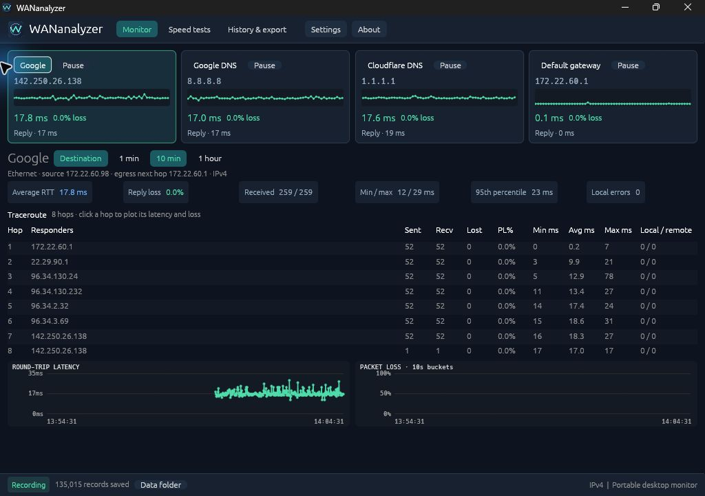

#  WANanalyzer

A Rust Windows desktop network monitor with continuous latency, traceroute, per-hop packet loss, local history, and native speed-test cards backed by four genuine providers.



*Monitor view with live target summaries, per-hop statistics, and latency/loss charts.*

**Early preview for Windows 10/11 x64.** See [validation and remaining qualification](VALIDATION.md) before relying on a release for extended monitoring.

## Run

Download the Windows x64 ZIP from [GitHub Releases](https://github.com/TheGlitchr/WANanalyzer/releases), extract it into a writable folder, and open `WANanalyzer.exe`. No installation is required. All four defaults start automatically: `google.com`, `8.8.8.8`, `1.1.1.1`, and the selected IPv4 default gateway. Default timing is one endpoint ping per second and one TTL sweep every five seconds. No administrator rights or capture driver are required.

The EXE creates a `data` folder beside itself. Keep that folder to retain sessions, settings, and results. Use a writable local folder or USB drive; an active SQLite database on a network share is unsupported. You can override the location:

```powershell
./WANanalyzer.exe --data-dir C:/NetworkLogs
```

Select a target, then click a hop number to inspect that hop's latency and packet-loss chart. The table includes sent, received, lost, PL%, min/average/max RTT, and local/remote errors. Rates follow the selected time window and latest network segment. Local errors are excluded from network-loss denominators. A router ignoring TTL probes can show high hop PL% while the destination remains healthy.

The app opens maximized at 90% interface scale. Target cards show route/probe status and pause/resume controls. The hop table has fixed numeric columns, a flexible responder column, and its own scroll areas for long traces or narrow windows; latency/loss charts sit beneath it. The recording status bar shows saved and unsaved counts and provides a **Data folder** shortcut.

**Settings → Interface scale** adjusts the entire native interface. Settings remain a draft until **Apply & save**; **Cancel**, **Escape**, or clicking outside the dialog discards unapplied edits, and **Restore defaults** resets the draft. Settings and About open as centered dialogs with keyboard focus contained and scrolling content for smaller screens. Display scale and sampling settings persist together. Use **Ctrl+1**, **Ctrl+2**, and **Ctrl+3** to switch to Monitor, Speed tests, and History & export, **Ctrl+,** for Settings, and **F1** for About when the app controls have keyboard focus.

## Speed tests

The tab presents four native cards with **Run** buttons: **WiFiman**, **Speedtest.net**, **FAST.com**, and **Devina bufferbloat**. The genuine provider runs in a background WebView2 browser while the app reads its rendered results. Only one speed test runs at a time; monitoring continues independently.

Every attempt enters **Test history** on the left, including canceled and failed runs. All providers use the same single-line log fields; longer text truncates with a tooltip. Click a result or **Details** to see its measurements, capture notes, and provider text. **All attempts / Saved results** filters the log; **Show log** controls its visibility.

- WiFiman provides download, upload, and provider ping.
- Speedtest.net also supplies idle, download-loaded, and upload-loaded latency.
- FAST provides unloaded latency and one loaded-latency measurement. It does not identify separate loaded values for both directions, so the app keeps that value separate.
- Devina supplies idle latency and added delay under download/upload load. The app displays each loaded total as idle plus the corresponding reported increase, retaining both values in history.

A `--` means a measurement was not reported; native ICMP results are never substituted for provider latency. Values from different providers use different paths and methods.

The website is hidden by default. **Show provider page** opens the active provider inside the main window for consent, interaction, or troubleshooting; **Back to results** returns to native cards. Visible pages retain **25% zoom**. Press **F6** inside the browser to return keyboard focus to app controls. **Cancel** stops and logs the active attempt.

An existing **Microsoft WebView2 Runtime** is required; nothing is installed automatically. The EXE embeds the Microsoft-signed loader and extracts it when needed. Logs, settings, browser cache, and the loader are generated runtime files beside the portable EXE's data folder.

Capture is experimental and versioned: each adapter waits for a fresh active test and two matching completed measurements. Provider layout changes, challenges, or unreported measurements can prevent capture; the app records the failure rather than inventing a result. Provider notices remain accessible in the optional browser view. No remote host objects or filesystem/shell bridge are exposed.

See [Native speed-test architecture and measurement semantics](NATIVE_SPEED_TESTS.md). Provider conditions for public distribution and the full Windows 10/11 qualification matrix remain open.

## History and export

**History & export** reopens earlier sessions, exports probes to CSV or probes plus speed tests and events to JSON, and creates a consistent SQLite backup of all retained history. Timestamps and units are explicit in exports. Export buttons use the selected historical session, or the current live session when no historical session is selected. **Live monitoring events** always shows the current session's events, including while historical charts are open.

Exports and snapshots run in the background with progress shown in the interface. They flush queued records before reading and write to a temporary sibling file before replacing the destination, preserving an existing output if writing fails. The active database and its SQLite working files cannot be selected as export destinations. Settings also save through a temporary file.

The native UI displays the most recent bounded sample buffer with 1-minute, 10-minute, and 1-hour windows. Full retained raw observations remain available in exports.

Raw measurements retain 24 hours by default, configurable to 1–168 hours. Speed records retain 365 days. The current implementation does not yet create the PRD's 30-day minute rollups or enforce its proposed 2 GiB budget. Monitor free space during extended use. A write failure or queue overflow is visible as an unsaved-record count; the app does not turn those gaps into network loss.

## Application icon

The custom **Signal Orbit** icon combines a mint waveform W, network nodes, and a blue routing orbit. Its 16–256 px Windows icon frames are embedded in the EXE; the same artwork is compiled into the app for its window/taskbar icon. No external icon file is needed when distributing the EXE. Artwork lives in `assets/wanalyzer.svg`, `assets/wanalyzer.png`, and `assets/wanalyzer.ico`; `scripts/generate-icon.ps1` regenerates the raster/ICO assets from matching vector geometry using Windows' built-in drawing library.

## Build

Rust 1.99.1 was used locally; dependencies are pinned in `Cargo.lock`. Windows x64 only. MSVC is the planned standard release target:

```powershell
# Requires Rust's MSVC toolchain and Visual Studio C++ build tools / Windows SDK.
./scripts/build.ps1 -Toolchain msvc -Test
```

The current environment had GNU-host Rust but no C compiler. A project-local LLVM-MinGW route is also provided; it does not change the machine-wide compiler installation:

```powershell
./scripts/setup-portable-toolchain.ps1
./scripts/build.ps1 -Toolchain gnullvm -Test
```

The portable setup downloads pinned LLVM-MinGW from its official GitHub release, checks its published SHA256 when provided, and adds the Rust target. It assumes Rust/rustup is already installed. `.tools`, `target`, `artifacts`, generated logs, and release binaries are ignored by Git.

After building, run `./scripts/package-release.ps1` to create the Windows x64 ZIP and `dist/SHA256SUMS.txt`. Packaging uses an explicit file list in a fresh staging directory and excludes runtime data. GitHub Actions also builds and tests the MSVC target and uploads the EXE, ZIP, and checksums as workflow artifacts.

For focused diagnostics without a GUI:

```powershell
./dist/WANanalyzer.exe --headless-seconds 15 --data-dir ./diagnostics
# Writes diagnostics/diagnostics.json and the ordinary SQLite session history.
```

## Implementation status and remaining qualification

Implemented: Windows ICMP worker pool, paced scheduler (40 probes/s, at most 32 in flight), automatic targets/gateway, repeated TTL measurements, per-hop PL tracking, pause/resume, native charts, settings, SQLite batching/recovery, exports, four provider adapters, and durable speed/loaded-latency results in a uniform native UI.

Differences from the full proposed v1: IPv4/x64 only; network changes are reconciled by polling every five seconds rather than native notifications; DNS uses a background Windows resolver; historical charts use the latest segment, and long-range rollups are pending. Data-folder recovery UX, comprehensive suspension/cancellation qualification, 24-hour soak, Windows 10 clean-VM validation, code signing, graphics compatibility, and the full dependency/license inventory still need release qualification.

The synchronous ICMP calls run on dedicated workers with private handles and owned stack buffers, avoiding asynchronous native-buffer lifetime hazards. The scheduler and database writer run independently of the UI. WebView2 is an asynchronous native child of the main window, owned by the same STA UI thread and message pump. The child is hidden on other tabs and while application dialogs are open; capture continues.

- [Product requirements](PRD.md)
- [Technical research and delivery plan](TECHNICAL_RESEARCH.md)
- [Microsoft WebView2 loader license](assets/webview2-notices/LICENSE.txt) and [notices](assets/webview2-notices/NOTICE.txt)

Research and implementation started November 7, 2026. No Ubiquiti affiliation or endorsement is implied.

## License and contributions

WANanalyzer's original code and artwork are available under the [MIT License](LICENSE). Dependencies retain their own licenses; releases include [third-party notices](assets/THIRD_PARTY_NOTICES.txt) and the WebView2 loader's license and notices. External speed-test services remain subject to their own terms.

Report bugs with your Windows version, app version, reproduction steps, and relevant error text. Review exported logs and screenshots before attaching them: network measurements can contain IP addresses, hostnames, and provider details. Local logs, browser profiles, caches, and build outputs are excluded from the source repository.
