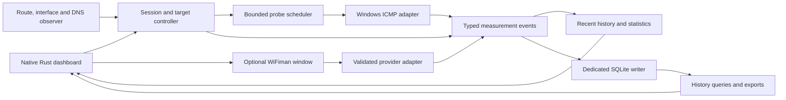

# WANanalyzer — Technical research and delivery plan

Research date: November 7, 2026.
Scope: archived feasibility/design findings from the research stage. Implementation has since started; see [README](README.md) for the current build, validation, and deviations.
Product contract: [PRD](PRD.md).

November 8 implementation update: [Native speed-test architecture](NATIVE_SPEED_TESTS.md) supersedes the original browser presentation below. Four DOM adapters now feed native cards and a shared log; the original feasibility findings remain archived here.

## 1. Findings and recommendation

Build the monitoring application as a native Rust executable using eframe/egui, Windows IP Helper ICMP APIs, and bundled SQLite. Load an optional, dedicated WebView2 window only when the user requests WiFiman. This matches the confirmed definition of portability: one distributed EXE, no required application installation, existing WebView2 acceptable.

The largest uncertainty is automatic WiFiman result capture. No public client API, SDK, or documented completion/export callback was located in the official material searched. A top-level browser view is a credible experiment, but hosting capability does not establish provider support, permission, or reliable result extraction. Resolve that integration before investing heavily in the full product.

| Area | Assessment | What remains unproven |
|---|---|---|
| IPv4 ping and TTL tracing | Strong documented Windows API path | Actual Rust implementation, standard-user behavior, ABI, and lab correctness. |
| Gateway and egress discovery | Documented route/interface APIs | Product selection policy across VPNs, tunnels, and ties. |
| Native Rust dashboard | Suitable frameworks exist | Plot performance, renderer compatibility, accessibility, and final dependency choices. |
| Embedded local history | Straightforward embedded SQLite path | Write throughput, retention, recovery, and portable-directory behavior. |
| Single distributed EXE | Feasible with static CRT, bundled SQLite, static WebView2 loader | Final PE imports and clean-VM execution. |
| Genuine WiFiman test in app | Plausible top-level WebView2 hosting | Service behavior in that host and applicable provider conditions. |
| Automatic WiFiman result logging | Unresolved release gate | Approved capture contract/adapter and reliable completion detection. |

Assessments above are engineering conclusions from documentation and source inspection, not measured prototype results.

## 2. Architecture

Recommended boundaries are conceptual at this stage; they do not require a large multi-crate repository:

| Component | Responsibility |
|---|---|
| Session/domain layer | Stable target identities, settings, measurement segments, outcomes, metric definitions. |
| Windows platform layer | ICMP calls, route/interface/address notifications, DNS, power/resume events. All native unsafe/FFI logic stays here. |
| Scheduler | Monotonic deadlines, rate limiting, endpoint priority, TTL sweeps, bounded in-flight work. |
| Statistics/history | Windowed computations, bounded recent buffers, downsampled plot data, historical queries. |
| Persistence | Schema migrations, batched inserts, acknowledged important events, retention and snapshot export. |
| Native UI | Overview, hop tables, timelines, speed history, settings, and visible recording state. |
| WiFiman adapter | Optional browser lifecycle, one active run, validated completion/capture, no general native privileges exposed to the page. |

Network collection must not depend on UI repaint calls. Collection continues while minimized, while reviewing old history, and while WebView2 is starting or displaying a test. UI updates may be coalesced; measurement records may not disappear silently.

## 3. Windows ping and traceroute implementation

### Use IP Helper, not a shell command loop

Microsoft exposes IPv4 ICMP handles and asynchronous echo operations with source address, timeout, and packet options. Rust can call them through Microsoft's bindings. [IcmpCreateFile](https://learn.microsoft.com/en-us/windows/win32/api/icmpapi/nf-icmpapi-icmpcreatefile), [IcmpSendEcho2Ex](https://learn.microsoft.com/en-us/windows/win32/api/icmpapi/nf-icmpapi-icmpsendecho2ex), [Rust binding](https://microsoft.github.io/windows-docs-rs/doc/windows/Win32/NetworkManagement/IpHelper/fn.IcmpSendEcho2Ex.html)

| API/type | Intended use |
|---|---|
| `IcmpCreateFile` / `IcmpCloseHandle` | Own an IPv4 ICMP handle with explicit lifetime. |
| `IcmpSendEcho2Ex` | Submit endpoint and TTL-limited probes; record the selected source address. |
| `IP_OPTION_INFORMATION.Ttl` | Set the outgoing IPv4 TTL. |
| `ICMP_ECHO_REPLY` | Read responder, status, and integer-millisecond RTT. |
| `IcmpParseReplies` | Parse an asynchronously completed native reply buffer. |

Setting successively larger TTLs yields intermediate TTL-expired responses until the destination responds or the hop cap is reached. This is the same underlying diagnostic method described by Microsoft for TRACERT. [Packet options](https://learn.microsoft.com/en-us/windows/win32/api/ipexport/ns-ipexport-ip_option_information), [TRACERT behavior](https://learn.microsoft.com/en-us/troubleshoot/windows-server/networking/trace-route-troubleshoot-tcp-ip-problems)

Raw Windows sockets require administrative privileges. Prefer IP Helper and verify standard-user operation in the first networking spike. Embed an `asInvoker` application manifest. Do not install Npcap, require a privileged service, alter routes, or change firewall rules as part of normal operation. [Windows raw sockets](https://learn.microsoft.com/en-us/windows/win32/winsock/tcp-ip-raw-sockets-2), [Privilege guidance](https://learn.microsoft.com/en-us/windows/win32/secbp/running-with-administrator-privileges)

### Preserve timing and status correctly

Native reply records expose RTT in milliseconds. Microsoft's current .NET implementation explicitly preserves native RTT even for received TTL-expired and unreachable replies, which supports per-hop plotting through direct Rust FFI. Some older high-level examples discard unsuccessful-status RTTs and are a poor reference for this design. [Reply structure](https://learn.microsoft.com/en-us/windows/win32/api/ipexport/ns-ipexport-icmp_echo_reply), [Microsoft implementation](https://raw.githubusercontent.com/dotnet/runtime/main/src/libraries/System.Net.Ping/src/System/Net/NetworkInformation/Ping.Windows.cs)

Classification proposal:

| Result | Endpoint interpretation | TTL-sweep interpretation |
|---|---|---|
| Echo Reply / `IP_SUCCESS` | Successful endpoint sample | Destination reached at this TTL. |
| `IP_TTL_EXPIRED_TRANSIT` | Not endpoint success | Responding intermediate hop, with responder RTT. |
| Timeout | Finalized missing reply | No visible response at this TTL; keep exploring higher TTLs. |
| Remote unreachable/prohibited | Explicit remote failure, retain native code | Error observation; distinguish from an ordinary TTL timeout. |
| Local route/send/API error | Local diagnostic; exclude from network-loss denominator | Local diagnostic, not evidence of router forwarding loss. |
| Pending/canceled/skipped | Not a finalized network measurement | Not a finalized hop measurement. |

Retain native codes so later bug fixes do not require guessing from a simplified label. For ambiguous errors where the API does not prove remote provenance, classify conservatively as local/unknown and exclude them from remote-loss claims.

### Native resource safety

Asynchronous calls may complete immediately or return pending. The event, request/reply buffers, handle, and identity metadata must remain valid until the native operation is finished and parsed. Application cancellation or a UI timeout is not by itself permission to release memory that Windows may still access. Use owned request objects and a single explicit completion/finalization path.

Microsoft's parser documentation includes 64-bit considerations involving `ICMP_ECHO_REPLY32`; use the published bindings and validate actual layout, reply-buffer sizing, alignment, pointer lifetime, and multiple-reply handling on x64. Do not handwrite an assumed C structure layout. [IcmpParseReplies](https://learn.microsoft.com/en-us/windows/win32/api/icmpapi/nf-icmpapi-icmpparsereplies)

The implementation spike must verify whether handles can be shared safely under the chosen concurrency pattern; a small managed handle/request pool is preferable to assumptions about unrestricted reuse. Keep native completion waits off the UI thread.

## 4. Sampling and probe load

The following values are proposed product defaults, not vendor requirements:

| Setting | Proposed value | Reason |
|---|---|---|
| Endpoint interval | 1 second | Useful outage/latency detail without aggressive traffic. |
| TTL sweep interval | 5 seconds | Repeated per-hop history with lower router-response load. |
| Maximum TTL | 30 | Familiar initial cap; incomplete routes remain explicitly incomplete. |
| Reply timeout | 1,000 ms | Responsive UI; configurable for high-latency paths. |
| Echo data | 32 bytes | Small probe payload; save actual configured size. |
| Global pacing | At least 25 ms between submissions | Maximum 40 submitted probes/second. |
| In-flight limit | 32 | Bound native resources and worst-case nonresponse. |

Worst-case average traffic when all four traces require 30 TTLs:

- Trace: `4 × 30 / 5 = 24` probes/second.
- Endpoint: `4 / 1 = 4` probes/second.
- Total: 28 probes/second, or about 2.42 million observations/day.

With three 30-hop public traces and a one-hop gateway, the average is 22.2 probes/second, about 1.92 million observations/day. These are upper-workload examples, not bandwidth/CPU measurements. They explain why storage, write batching, and plot downsampling matter even with only four targets.

Use monotonic deadlines, a single global paced submission queue, and bounded concurrent TTL discovery. Reserve capacity for endpoint deadlines; schedule TTL work fairly across targets. Do not wait serially for every TTL timeout before advancing the entire trace: use a small discovery window so silent hops do not make startup take tens of seconds.

Do not overlap one target's sweeps. If a sweep cannot finish before the next scheduled one, skip/defer it and record the scheduling gap. Never replay overdue probes in a burst after suspend, CPU contention, or database trouble. Startup and post-change route discovery should favor quick partial visibility, with all measurements timestamped individually.

## 5. Default gateway, VPNs, and DNS

### Gateway policy

Windows exposes routes, their metrics, and adapter/gateway metadata. Effective preference includes interface metric plus route metric. `GetBestRoute2` separately reports route/source selection for a particular destination. [Route enumeration](https://learn.microsoft.com/en-us/windows-hardware/drivers/network/getipforwardtable2), [Route metrics](https://learn.microsoft.com/en-us/windows/win32/api/netioapi/ns-netioapi-mib_ipforward_row2), [Best route](https://learn.microsoft.com/en-us/windows/win32/api/netioapi/nf-netioapi-getbestroute2), [Adapter enumeration](https://learn.microsoft.com/en-us/windows/win32/api/iphlpapi/nf-iphlpapi-getadaptersaddresses)

Proposed application policy:

1. Enumerate IPv4 routes and join them to currently usable interfaces.
2. Consider active `0.0.0.0/0` routes. Rank by effective metric; use a documented stable interface-ID/next-hop tie-break when Windows exposes equal candidates.
3. Show the selected route's adapter, metric, and next hop. The tie-break is the application's display policy, not a claim to predict every equal-cost forwarding choice.
4. Probe only a concrete usable next-hop address. An on-link/tunnel default with an unspecified next hop is a visible **No pingable gateway** condition.
5. Independently record best route/source per public destination. A VPN's more-specific route can supersede a physical default route, so these views may differ legitimately.
6. Recompute state after route/address/interface changes and resume; start a new segment when source, destination, selected gateway, or relevant route identity changes.

Bind probes to the OS-selected source address where appropriate, but do not claim this alone guarantees an interface under all policy-routing configurations. Preserve observed selection context and validate VPN behavior in the lab.

Subscribe to route and interface notifications, debounce bursts, then requery full state. Do not build authoritative state only from an individual notification row. Add address-change observation and a periodic low-frequency reconciliation as recovery from missed notifications. [Route notifications](https://learn.microsoft.com/en-us/windows/win32/api/netioapi/nf-netioapi-notifyroutechange2), [Interface notifications](https://learn.microsoft.com/en-us/windows/win32/api/netioapi/nf-netioapi-notifyipinterfacechange)

### DNS policy

Resolve `google.com` through the Windows resolver on a worker/asynchronous path. `GetAddrInfoExW` supports asynchronous resolution and timeout handling. Request IPv4 explicitly for v1. Literal-IP targets must never wait behind DNS. [GetAddrInfoExW](https://learn.microsoft.com/en-us/windows/win32/api/ws2tcpip/nf-ws2tcpip-getaddrinfoexw)

Pin one selected A address within a measurement segment; preserve the complete returned address set as optional resolution metadata. Requery on network change, explicit retry, and a proposed 5-minute refresh timer. Rely on the Windows resolver cache rather than bypassing configured DNS servers. If a later successful lookup changes the selected address, record that transition and separate statistics. On lookup failure, retain the prior address only with a visible stale-resolution marker; never silently reassign historical samples.

Optional reverse DNS uses separate bounded work and caching. Displaying a hop name cannot delay probing or replace its actual address as identity.

## 6. IPv6 decision

Recommend explicitly IPv4-only monitoring for this first version. Two required public targets are literal IPv4 addresses, and limiting the address family reduces the first implementation's lifetime and gateway-scope risks.

IPv6 requires separate ICMP APIs, scoped link-local handling, and its own acceptance matrix. Microsoft's `Icmp6SendEcho2` documentation says the timeout argument is ignored for asynchronous calls, so a straightforward copy of the IPv4 cancellation model is insufficient. [Icmp6SendEcho2](https://learn.microsoft.com/en-us/windows/win32/api/icmpapi/nf-icmpapi-icmp6sendecho2)

Keep address family and interface scope in the conceptual data model. On IPv6-only connectivity, report that the requested IPv4 monitoring is unavailable; do not invent a gateway or imply internet connectivity is absent. WiFiman's browser traffic may use a different address family than the native probes, and its record should not imply an IPv4-only test unless proven.

## 7. Statistics and honest interpretation

The PRD defines exact denominators and windowing. Implement those definitions in one domain layer shared by live views, history, and exports.

- Compute endpoint statistics separately from TTL observations; do not double-count the trace's destination reply as an extra endpoint ping.
- Include only finalized, actually submitted measurements in rate statistics. Pending/unsent/canceled/local-error periods remain distinct.
- Use integer-ms native RTT as the primary network measurement. High-resolution application elapsed time can diagnose scheduling delay but is not a replacement network RTT.
- Store UTC wall-clock timestamps for cross-feature correlation and monotonic elapsed durations for scheduling. Mark discontinuities rather than interpreting wall-clock jumps as latency.
- Reset adjacency for RTT variation after a missing probe, pause, address transition, or network transition.
- For rollups, combine weighted counts and sums. Do not average independently calculated means or variation values.
- Do not infer an exact p95 from minute means/min/max. Either omit it for aggregated history or later add a validated approximate-distribution representation with a clear label.

“Jitter” has several meanings; RFC 3393 defines a one-way delay-variation metric. The proposed mean absolute difference between adjacent RTTs is an application metric and should be labeled accordingly. [RFC 3393](https://www.rfc-editor.org/rfc/rfc3393.html)

Intermediate routers can respond differently to diagnostic traffic than to forwarded traffic. A quiet TTL with a healthy final endpoint is incomplete hop visibility. Load balancing, tunnels, asymmetric return paths, and ICMP filtering limit conclusions; even destination ICMP non-response does not prove HTTP/DNS/application failure. Show observations and correlation, without automated claims that one router caused an outage. [Microsoft TRACERT](https://learn.microsoft.com/en-us/troubleshoot/windows-server/networking/trace-route-troubleshoot-tcp-ip-problems), [Pingman interpretation guidance](https://www.pingman.com/kb/24)

Key a hop series by target, address family, destination segment, network segment, TTL, and responder address. Keep timeouts associated with the TTL/sweep, not falsely attributed to whichever router last answered there. Record responder changes as observations; missing replies alone should not be announced as proven topology changes.

## 8. WiFiman research: documented, observed, and unknown

### What the public material establishes

The live WiFiman root response was observed to contain `X-Frame-Options: SAMEORIGIN`; its application requires JavaScript. This rules out a local application's iframe design under that response. The header is a dated observation, not a permanent API contract. [WiFiman.com](https://wifiman.com/)

Public result pages demonstrate visible download/upload, ping, server/ISP information, and result identifiers. Their existence does not establish an export API or a durability promise for share URLs. [Example result page](https://wifiman.com/?result=c2c4f657-e4ec-40cb-9899-b84f50bf808a)

The official [server-hosting page](https://wifiman.com/host) concerns supplying test servers. It does not document a third-party client integration. Searches of official help, developer, and community resources did not locate a public WiFiman client API, Windows automation CLI, or supported result-completion callback.

Some official material is inconsistent about the separate WiFiman Desktop application's feature set: the help page describes limited desktop features, while newer desktop release notes discuss speed tests. Neither supplies a supported automation bridge for this project. Do not assume a desktop CLI exists from either source. [Help article](https://help.ui.com/hc/en-us/articles/205204150-Using-WiFiman), [Desktop release notes](https://community.ui.com/releases/1125a09a-f4ec-4a8a-9fc4-1562d7c7e151)

### Provider conditions to resolve

Ubiquiti's terms contain licensing and use restrictions addressing modification, redistribution/display, reverse engineering, and related services, alongside data and service-change provisions. These raise distribution/integration questions; this research does not determine a legal prohibition on ordinary embedded browsing. Ask the provider about the actual intended use before shipping automated capture. [Ubiquiti Terms of Service](https://www.ui.com/legal/termsofservice/)

Clarification should cover top-level embedded browsing, automatic extraction and local storage, public/internal distribution, attribution, rate limits, and a possible supported callback/partner API. No contact has been made as part of this research.

### Proposed integration order

| Option | Technical/product assessment |
|---|---|
| Provider-approved API or callback | Preferred. Establish completion, fields, units, auth, limits, and distribution terms directly. |
| Top-level WebView2 + permitted visible-result adapter | Credible experiment; subject to provider conditions and brittle page/layout/localization changes. |
| Local iframe | Rejected by currently observed frame restriction. |
| Reverse-engineered private endpoints/test engine | Do not make this the architecture; undocumented behavior and provider-condition risk. |
| External browser + manual logging/import | Contingency only; loses automatic result capture without extra supported integration. |
| Another provider such as LibreSpeed/Ookla | Different product requirement; evaluate only if the user changes scope. |

Microsoft documents native JavaScript execution in WebView2. That permits interaction with a hosted page technically, but says nothing about WiFiman support for a DOM-based adapter. If allowed, isolate such an adapter, version it, read completed user-visible values only, normalize units, and fail clearly on an unrecognized page. A small embedded JavaScript adapter may be necessary despite the application itself being Rust. [WebView2 JavaScript mechanisms](https://learn.microsoft.com/en-us/microsoft-edge/webview2/how-to/javascript)

Do not assume the app's Run button can directly trigger an undocumented provider action. A valid v1 experience may open the genuine integrated page and let the user press its own Start control; automatic capture after completion remains required. Capture the whole launch-to-terminal interval, and record provider phase boundaries when reliably exposed.

## 9. Browser hosting, isolation, and runtime behavior

### Hosting choice

The user's November 8 revision requires a picture-in-picture panel inside the main window's Speed tests tab. The implementation therefore hosts WebView2 directly as a child of eframe's Win32 HWND. WiFiman remains the top-level document of that browser, so HTML iframe restrictions do not apply.

The selected implementation uses `webview2-com` with asynchronous environment/controller creation on eframe/winit's owning STA UI thread. Winit supplies the message pump. Controller bounds follow the panel's client coordinates converted from egui points to physical pixels, and visibility follows tab/dialog state. Completion commits on the database writer before the UI reports success. No second native event loop or top-level browser window is created.

WebView2 must be created and used on its owning STA thread with a functioning message pump; callbacks must not synchronously block it. Validate focus, DPI/resize, tab visibility, shutdown, and minimized capture. [Microsoft threading model](https://learn.microsoft.com/en-us/microsoft-edge/webview2/concepts/threading-model), [Controller bounds and visibility](https://learn.microsoft.com/en-us/microsoft-edge/webview2/reference/win32/icorewebview2controller), [eframe native handle](https://docs.rs/eframe/latest/eframe/struct.Frame.html)

### Trust boundary

Treat the remote page as untrusted content even when it has the expected origin. Expose no shell, filesystem, arbitrary HTTP proxy, database query, or generic host object. Native collection must remain accessible only through the application's own local UI.

If a permitted result bridge is used, accept only a small versioned schema bound to the active run. Validate the event's source, current exact HTTPS origin, active-run identity, field types, finite numbers, reasonable size, and units. Prevent duplicate terminal commits with a database uniqueness constraint. Bound top-level navigations and new windows without assuming all necessary test-server subresources share the main origin. Review those resources during the spike. [Microsoft WebView2 security](https://learn.microsoft.com/en-us/microsoft-edge/webview2/concepts/security)

A nonce/run ID helps correlate stale callbacks; it does not make remote JavaScript trusted. Store provenance and never present a captured provider value as an independently verified native measurement.

### Runtime and data

Use the existing production WebView2 Runtime and detect it explicitly. Microsoft documents its inclusion on Windows 11 and broad Windows 10 availability, but applications still need a missing-runtime path. Installed Microsoft Edge Stable is not a substitute for the production runtime. Do not automatically install anything under the confirmed scope. [WebView2 distribution](https://learn.microsoft.com/en-us/microsoft-edge/webview2/concepts/distribution)

Statically link the small WebView2 loader when building MSVC; this does not embed the browser engine. The Rust bindings' source links `WebView2LoaderStatic` for MSVC, establishing a plausible no-loader-DLL distribution path. Final build verification is still required. [Microsoft static loader](https://learn.microsoft.com/en-us/microsoft-edge/webview2/how-to/static), [Rust loader linkage source](https://github.com/wravery/webview2-rs/blob/main/crates/bindings/src/lib.rs)

Create a separate app-owned browser user-data folder under the selected writable data directory. Browser cookies/cache/permissions create files even though one EXE is distributed. Keep them out of exports and allow clearing browser data when the view is closed. Do not navigate to WiFiman during startup. [User-data folders](https://learn.microsoft.com/en-us/microsoft-edge/webview2/concepts/user-data-folder)

## 10. UI and Rust dependency decisions

| Approach | Advantages | Tradeoffs | Recommendation |
|---|---|---|---|
| eframe/egui | Rust-native dashboard, tables, custom drawing; core need not depend on WebView2. | Custom appearance, version churn, renderer/accessibility validation. | Preferred baseline. |
| Slint | Declarative UI with documented Windows 10/11 support. | More chart work; select and satisfy the applicable license/attribution terms. | Credible alternative if UI requirements outweigh chart convenience. |
| Tauri | Mature web frontend options and chart ecosystem with Rust backend. | Entire UI depends on WebView2 and usually a frontend toolchain; missing runtime affects core dashboard. | Less aligned with independent portable monitoring. |

[eframe](https://docs.rs/eframe/latest/eframe/), [egui project and license](https://github.com/emilk/egui), [Slint Windows support](https://docs.slint.dev/latest/docs/slint/guide/platforms/desktop/windows/general/), [Slint license FAQ](https://github.com/slint-ui/slint/blob/master/FAQ.md?plain=1), [Tauri Windows distribution](https://tauri.app/distribute/windows-installer/)

`egui_plot` offers appropriate plotting primitives, but its current documentation includes a maintainer request. Treat that as a maintenance signal, isolate plot rendering behind application-owned data/view types, and keep direct egui drawing as a fallback. Validate aligned timelines, missing data, hover, zoom, and min/max-preserving decimation before committing. [egui_plot](https://docs.rs/egui_plot/latest/egui_plot/)

Proposed dependency roles, with exact versions deliberately deferred until implementation:

- `windows` or `windows-sys`: Windows networking/platform calls. Prefer one consistent generated-binding family per boundary.
- `eframe`, `egui`, and potentially `egui_plot`: compatible, pinned UI versions.
- `rusqlite` with `bundled`: embedded SQLite.
- `webview2-com`, optionally Wry: browser host after the lifecycle spike.
- `serde`, JSON/CSV serialization, and one time-handling library: versioned configuration and exports.
- A bounded channel/scheduler approach; use Tokio only if it simplifies the chosen native-completion model. Rust `async` does not automatically make an ICMP operation cancelable or release its native buffers safely.
- Structured local diagnostics with bounded retention and sensitive-data minimization.

No application dependency manifest or lockfile is warranted during this research-only stage. At implementation, pin versions, retain the lockfile, review licenses/advisories, and keep a dependency inventory for distribution.

## 11. Persistence model and capacity

Use SQLite with a dedicated writer and `rusqlite`'s bundled feature. The project documents building the vendored SQLite C source into the application, avoiding a user-installed SQLite DLL. [rusqlite build documentation](https://github.com/rusqlite/rusqlite#notes-on-building-rusqlite-and-libsqlite3-sys)

Conceptual entities, not a proposed SQL schema:

| Entity | Essential information |
|---|---|
| Session | Application version, start/end UTC, status, settings snapshot, schema version. |
| Logical target | Stable ID, configured hostname/IP or gateway role, enabled state. |
| Network segment | Adapter identity/LUID, source/address family, selected gateway/route, start/end, reason. |
| Target address segment | Logical target, exact destination, resolution time, associated network context. |
| Endpoint observation | Submission/finish times, sequence, timeout/payload settings, native outcome, RTT, segment IDs. |
| Trace sweep | Destination/context, start/end, termination reason, hop cap. |
| TTL observation | Sweep, TTL, responder if any, native status, RTT if meaningful, attempt identity. |
| Speed-test run | Provider, run ID, start/end, outcome, Mbps/ping, optional server/result URL, capture version, start/end network context, durable-save state. |
| Event | Pause/resume, route/DNS changes, suspend/resume, logging failure, collection gaps, speed-test markers. |
| Minute summary | Per-series counts, timing sums/extrema, variation pair count/sum, bucket boundaries. |

Indexes should serve target/segment/time and session/time queries, with minimal redundant indexes on high-volume raw observations. Do not store repeated adapter names, hostname strings, or large serialized context in every row.

At the 1.92–2.42 million observations/day examples, an illustrative all-in 100–200 bytes per observation implies roughly 190–485 MB/day before any extra index/WAL overhead outside that assumption. This is a sizing hypothesis, not a SQLite benchmark. Measure actual database growth early, including indexes, WAL, and free-list reuse.

Use raw 24-hour retention and 30-day minute summaries as proposed in the PRD. Keep speed results longer because their volume is low. Preserve counts/extrema through compaction; label when raw detail has expired. Bound both the recent in-memory ring buffers and the writer queue.

### Durability and portable-folder details

WAL allows readers and a writer to coexist but introduces `-wal` and `-shm` sidecars and requires a local filesystem. Use SQLite's backup API or an appropriate snapshot operation for live export; the main file alone may omit committed WAL data. [SQLite WAL](https://www.sqlite.org/wal.html), [Database file format](https://www.sqlite.org/fileformat.html), [Online backup API](https://www.sqlite.org/c3ref/backup_finish.html), [VACUUM INTO](https://www.sqlite.org/lang_vacuum.html)

Propose 1-second batched commits with `synchronous=FULL` initially; measure on SSD and USB before considering a weaker policy. The distinction between process-crash recovery, power-loss durability, and storage-device behavior must remain explicit. Never guarantee zero loss of uncommitted samples. [SQLite synchronization settings](https://www.sqlite.org/pragma.html#pragma_synchronous)

Important events, particularly speed-test initiation and terminal status, use acknowledged commits before the UI calls them saved. If storage cannot keep up, continue bounded live collection with visible unsaved/gap reporting; do not block the scheduler indefinitely or accumulate unlimited RAM. Recovery may record a lost interval, but cannot reconstruct measurements never durably stored.

Checkpoint WAL periodically. Long-lived history readers must not pin unbounded WAL growth; page/chunk queries and release read transactions. Use maintenance that reuses or reclaims space deliberately, keep disk-headroom checks, and stop claiming durable recording if the budget cannot be maintained.

Portable mode means all app-controlled writable state follows the selected data directory. It does not promise that Windows or the browser runtime leaves no OS-managed traces. Active removable-drive databases remain vulnerable to unsafe removal, so handle resulting I/O errors accurately.

## 12. WiFiman result lifecycle

Proposed lifecycle: **requested → provider loading → awaiting user/start or running → completed/canceled/failed/interrupted/capture failed**. Keep provider completion and durable-save acknowledgement separate internal facts so the UI can represent completed-but-unsaved results correctly.

- Commit a unique local run and initiation event before navigation.
- Bind all captured messages to the current run and provider adapter version.
- Ignore preexisting/cached results until a new provider start-to-completion transition or equally reliable new provider run identity is observed. A local nonce cannot establish freshness by itself.
- Accept a completion only after recognizing terminal provider state and validating the required numeric fields/units.
- Normalize decimal Mbps without inventing precision; retain provider-reported ping separately from native ICMP.
- Capture server/result ID only when available and validate any saved link's scheme/origin.
- Write the result and its final event in one transaction; a uniqueness rule prevents duplicate completion records.
- On app restart, mark unresolved runs interrupted. On network changes, retain start/end context and a mixed-context indicator.
- Support one provider test per embedded-window lifetime. End the test surface at the first terminal outcome and show the result/status locally; a retry or rerun requires a new app action and a fresh committed run. Cancellation/timeout must also stop or close the active browser test so untracked load does not continue.
- Do not keep cookies, auth tokens, arbitrary page HTML, or provider internals as default diagnostic evidence.
- Keep every speed-test interval visible in network history, including failed/canceled runs because they may have generated load.

If no durable directory is available, keep the speed-test panel's unsaved state explicit. Do not offer an apparently logged test that cannot satisfy its start/terminal persistence requirements; resolve storage or clearly identify any explicitly manual, unsaved contingency.

## 13. Portable Windows build and release

Target `x86_64-pc-windows-msvc`. Rust's MSVC client baseline is Windows 10 or later. Qualify Windows 10 22H2 x64 and Windows 11 x64 as separate required test environments. Older Windows 10 versions, Server, ARM64, and 32-bit are outside the initial claim. [Rust Windows platform support](https://doc.rust-lang.org/rustc/platform-support/windows-msvc.html)

Windows 10 compatibility is a deliberate application requirement; it does not extend Microsoft's OS support lifecycle. Recheck the applicable Windows/WebView2 support matrix at release time. [Microsoft Windows 10 lifecycle information](https://learn.microsoft.com/en-us/windows/release-health/release-information)

Select static MSVC CRT linkage using Rust's documented `crt-static` target feature. Configure bundled C dependencies consistently. Inspect the resulting PE imports to verify no unexpected Visual C++ runtime, SQLite DLL, or WebView2 loader DLL is required. Normal Windows system DLL dependencies remain expected. [Rust linkage reference](https://doc.rust-lang.org/reference/linkage.html#static-and-dynamic-c-runtimes)

Release packaging plan:

1. Reproducible, pinned release toolchain and dependency lockfile on Windows CI.
2. Optimized release EXE with product/version metadata, embedded `asInvoker` manifest, and license notices accessible from the app or accompanying release information.
3. Verify native runtime/library imports and optional WebView2 startup behavior on clean VMs.
4. Authenticode-sign and timestamp a public release using a consistent publisher identity; publish checksums.
5. Distribute the EXE without a mandatory installer. First run creates or selects the data folder.
6. Keep application updates manual in v1; replacing the EXE must preserve data and apply versioned, tested migrations.

Signing establishes publisher identity but cannot guarantee the absence of SmartScreen prompts. Microsoft documents reputation-based behavior, including that EV signing no longer grants immediate reputation. [Microsoft SmartScreen guidance](https://learn.microsoft.com/en-us/windows/apps/package-and-deploy/smartscreen-reputation)

Avoid claiming a binary-size target before measuring renderer and browser-binding choices. Existing WebView2 is consistent with the user's portability preference; bundling an entire browser runtime would change the distribution model unnecessarily.

## 14. Failure behavior

| Condition | Required response |
|---|---|
| No network at launch | Start the session/UI, show unavailable routes, retry without blocking history. |
| DNS failure | Keep literal targets alive; show DNS state separately. |
| No concrete default gateway | Keep gateway row visible and unavailable; do not invent a target. |
| Firewall/ICMP suppression | Preserve statuses and uncertainty; do not require firewall changes. |
| Route/IP changes | Close the prior measurement segment, requery, and record the change. |
| VPN during speed test | Mark changed/mixed network context and keep measurements. |
| Sleep or suspend | Stop interpreting the inactive interval as missing network replies; resume without backlog. |
| Manual clock adjustment | Preserve monotonic durations and record a wall-clock discontinuity. |
| WebView2 missing/crashed | Keep native monitor alive; report speed feature unavailable/failed. |
| Provider page changed | Fail capture visibly and retain the run event; never fabricate numeric results. |
| Slow/full/read-only storage | Bound buffers, show unsaved state, preserve earlier committed data. |
| Abrupt termination | Recover committed database state and mark incomplete runs/sessions interrupted. |

## 15. Validation strategy

No tests were run because there is no implementation. The following checks are future engineering work after authorization:

- **Focused unit tests:** metric denominators, nulls, variation adjacency, weighted rollups, address/network segmentation, capture schema validation, unit conversion, and duplicate-result finalization.
- **Native integration tests:** controlled ICMP responders/timeouts, TTL-expired RTT, immediate/pending completion, cancellation/late completion, x64 buffer layout, and bounded resources.
- **Topology lab:** known multi-hop path; one silent intermediate router; destination suppression; route changes; all-TTL nonresponse; gateway/on-link/VPN cases. Use an isolated lab rather than repeatedly loading public hosts for tests.
- **Provider validation:** at least 10 genuine completed WiFiman runs across wired/Wi-Fi and both operating systems; compare captured values to visible page values. Exercise initial cached results, duplicate completion, provider rerun, and cancellation/timeout. Record capture failure and external service variability separately from success.
- **Portable deployment:** standard-user Windows 10/11 VMs without developer tools/VC runtime installs; WebView2 present/missing; local/USB/read-only paths, spaces/non-ASCII, disk full, and process termination.
- **UI and endurance:** high DPI, keyboard operation, missing-data rendering, remote desktop/GPU compatibility, 24-hour soak, retention rollover, and history exports during collection.

Choose a renderer fallback policy during the UI spike. If the native framework's available renderers cannot support a tested Windows configuration, state the minimum graphics requirement; do not claim universal driver independence.

## 16. Delivery sequence and exit criteria

This is a proposed sequence, not authorization to begin coding or contact external parties.

| Stage | Work | Exit condition |
|---|---|---|
| 0 — Provider feasibility | Clarify WiFiman conditions; investigate supported capture route and distribution audience. | Integration approach is permitted for the intended use, or the unresolved condition is explicitly recorded before further investment. |
| 1 — Risk spikes | Minimal ICMP/TTL, clean-VM portable native window, and permitted WiFiman/WebView2 capture experiments. | Standard-user hop RTT, static dependency path, browser lifecycle, and automatic durable result capture demonstrated. |
| 2 — Monitoring engine | Target controller, gateway/DNS observation, paced scheduler, outcome model. | Four default workflows auto-start and survive network changes with correct classification. |
| 3 — Persistence and history | Embedded DB, migrations, batching, rollups, retention, exports. | Recovery, bounded storage, and stable schema/provenance pass focused tests. |
| 4 — Product UI | Four-target overview, selected hop table/timelines, events, settings/history. | Useful live and historical diagnosis with honest missing-data rendering. |
| 5 — Integrated speed feature | Production browser adapter, lifecycle, durable results, correlation markers. | WiFiman-specific PRD acceptance scenarios pass on Windows 10/11. |
| 6 — Release qualification | Soak, compatibility, imports, signing, documentation. | All required PRD acceptance cases pass; remaining platform limits documented. |

Do not assign a confident full-v1 delivery date until the WiFiman and native-lifetime spikes are complete. The provider dependency may require elapsed time unrelated to implementation effort.

## 17. Risk register

| Risk | Impact | Mitigation / decision |
|---|---|---|
| No supported/permitted WiFiman capture route | Full requested v1 cannot ship as specified. | Resolve first; keep release gate and require explicit scope change for substitutes. |
| Provider DOM/behavior changes | Capture becomes unreliable after release. | Versioned isolated adapter, unknown-page failure, visible provenance, regression cases. |
| WebView2 unavailable or future support changes | Speed feature unavailable on some PCs. | Detect existing runtime; native core independent; recheck Windows 10 support before release. |
| Unsafe async native buffers | Crashes or memory corruption. | Owned request lifetimes, real completion/finalization, ABI and cancellation integration tests. |
| VPN/multihomed ambiguity | Misleading gateway or history comparisons. | Explicit selection policy plus per-destination egress context and network segments. |
| ICMP diagnostic limitations | False fault attribution. | Conservative labels, endpoint-first interpretation, no automatic culprit claims. |
| Row volume and slow USB media | DB/queue growth, stalls, missing records. | Measure early, compact context, batching, retention, bounded queues, explicit gaps. |
| Plot dependency maintenance | Future upgrades or bug fixes become costly. | App-owned plot abstraction, pinned versions, direct drawing fallback. |
| Native/browser event-loop mismatch | Deadlocks, focus bugs, shutdown hangs. | Separate-window STA/message-pump spike; never block callbacks. |
| Signing/reputation and licenses | Distribution friction or obligations missed. | Publisher plan, honest SmartScreen expectations, dependency/license inventory. |

## 18. Research limits and next decision

The workspace was empty at the start, with no existing implementation to audit. Research used Microsoft, Rust/framework, SQLite, Ubiquiti, and Pingman primary materials, plus read-only inspection of the public WiFiman response. No compiled WiFiman assets were reverse engineered, no speed test was run, no provider was contacted, and no software was built.

Links to `latest` documentation and repository branches are mutable. Findings are dated; record exact toolchain/dependency revisions and repeat critical checks when implementation starts.

The next practical decision is whether the proposed v1 defaults are acceptable and how to obtain a supported/permitted WiFiman result-capture path. The native monitor can be implemented independently after authorization, but the full requested release remains conditional on that path being proven.
